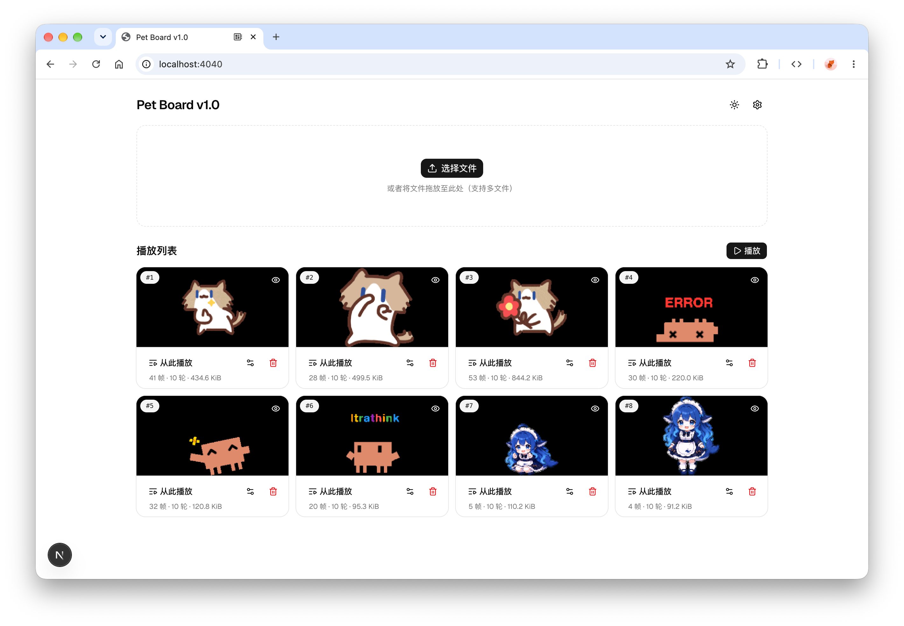

# Pet Board

**Pet Board** 是一款跑在 ESP32 C6/S3 的桌搭硬件，可通过浏览器串口（Web Serial）上传动图到 ESP32 播放动画。

> 这是一个业余学习项目：分享固件源码、网页控制台源代码和学习文档。

## 效果演示

<table>
  <tr>
    <th width="50%" align="center">实机运行</th>
    <th width="50%" align="center">网页控制台</th>
  </tr>
  <tr>
    <td align="center"><video src="https://github.com/user-attachments/assets/fe2f12ff-b4e7-4b61-a30c-0fe6dbe2a516" controls></video></td>
    <td align="center"></td>
  </tr>
</table>

## 功能一览

- **双硬件**：同时支持烧录和控制 ESP32 C6 和 ESP S3。
- **网页控制台**：不用装客户端，通过 USB-C 连接硬件，打开页面就能上传、播放。
- **脱机播放**：播放清单写在卡上，断开网页后固件继续循环。
- **高效动画**：自研帧差分动画格式 `.ANM` ，支持在极低配置的硬件上流畅播放 GIF/WebP 动画。

## 硬件和环境要求

> 仅在以下环境测试验证过，不保证其他环境运行正常。

**硬件**

| 硬件   | ESP32-C6 LCD 1.47"          | ESP32-S3 LCD 3.5"                 |
|--------|-----------------------------|-----------------------------------|
| 芯片   | ESP32-C6，RISC-V 最高 160MHz | ESP32-S3R8，Xtensa 双核最高 240MHz |
| Flash  | 8MB（封装在芯片内） / 无      | 16MB QSPI / 8MB OPI PSRAM         |
| PSRAM  | 无                          | 8MB OPI                           |
| 屏幕   | 1.47" ST7789，SPI，320×172    | 3.5" IPS ST77922，QSPI，480×320     |
| 存储卡 | microSD，SPI                 | microSD，SDIO 4-bit                |

**网页控制台**

> 建议打开 `https://micooz.github.io/petboard`

- 需要支持 Web Serial 的 Chromium 系浏览器（Chrome / Edge），不支持 Safari 桌面浏览器与 iOS 浏览器。
- 需要在安全上下文（`https://` 或 `http://localhost`）中打开。

## 开发

### 技术栈

- **Node.js & PNPM**：负责开发网页控制台。
- **Rust & Rustup**：负责编译 Rust 代码和 WASM。
- **espup**：负责编译 ESP32 S3 的 Xtensa 固件（注意 C6 是 RISC-V 无需 espup）。
- **espflash**：负责烧录固件。

## 项目结构

```text
petboard/
├── crates/
│   ├── fm-core/          # 共享 no_std 固件逻辑
│   │   ├── src/wire/     # PetBoard 消息层：命令、设备信息、播放清单
│   │   ├── src/commands/ # 上传 / 下载 / 播放 / 清单等命令实现
│   │   ├── src/link.rs   # Embassy 串口适配
│   │   ├── src/screen.rs # 画布与屏幕绘制
│   │   └── tests/        # 主机测试与线路契约用例
│   ├── fm-esp-c6/        # C6 接线：引脚、SPI2 共享、ST7789 驱动
│   ├── fm-esp-s3/        # S3 接线：ST77922 QSPI 驱动、SDIO 块设备、面板自检卡
│   ├── anmfmt/           # .ANM 动画格式权威实现，无依赖
│   ├── bmpfmt/           # .BMP 图片格式权威实现，无依赖
│   ├── serial/           # 通用串口线路编解码器（哨兵成帧、ID 配对、标签槽、块 ACK）
│   └── wasmfmt/          # 把格式实现暴露给浏览器的 wasm-bindgen 门面
├── web/                  # Next.js 静态导出 UI、Web Serial 客户端、编码器与 Vitest 测试
│   ├── src/components/   # 上传、媒体库、播放清单、连接状态等界面组件
│   ├── src/lib/          # 编码器、缓存、播放状态与串口客户端
│   │   ├── encode/       # 图片 / GIF / WebP → 卡上格式的编码入口
│   │   └── serial/       # Web Serial 传输层与生成的线路常量
│   ├── src/wasm/pkg/     # wasmfmt 的构建产物
│   └── tests/            # Vitest 测试，目录结构与 src/ 镜像
├── scripts/              # web.sh（开发服务器）、flash-c6.sh / flash-s3.sh（构建 + 烧录）
├── docs/                 # 中文笔记：嵌入式术语表、.ANM 规范、两块板的硬件资料
└── assets/               # 示例源动画（GIF / WebP 精灵图）
```

### 1. 烧录固件

```bash
./scripts/flash-c6.sh                # C6：编译 release → espflash 烧录 → 打开监视器
./scripts/flash-s3.sh                # S3，同上（没有 Xtensa 工具链时会先提示怎么装）
./scripts/flash-c6.sh --no-monitor   # 烧完不开监视器，把串口留给网页
./scripts/flash-s3.sh --lcd-test     # 只烧面板自检卡，用来确认屏幕方向和颜色
```

### 2. 启动网页

```bash
./scripts/web.sh                  # 装依赖 → 保证有 WASM 产物 → http://localhost:3000
./scripts/web.sh --port 5173      # 其它选项：--wire / --wasm / --no-wasm / --no-install
```

### 3. 在网页里使用

1. 用 USB-C 线把板子接到电脑，浏览器打开 `http://localhost:3000`。
2. 点「选择串口」，选那个通常带 `usb` 字样的端口。
3. 拖入图片 / GIF / WebP，等转换与上传跑完。
4. 点播放（可调整顺序和每条动画的播放参数），之后就可以关掉网页了。

## 学习文档

| 文件                                                     | 内容                |
|----------------------------------------------------------|---------------------|
| [`docs/basics.md`](docs/basics.md)                       | 嵌入式通用知识      |
| [`docs/anm-format.md`](docs/anm-format.md)               | `.ANM` 动画格式规范 |
| [`docs/esp32-c6-lcd-147.md`](docs/esp32-c6-lcd-147.md)   | C6 板的相关信息     |
| [`docs/esp32-s3-lcd-35.md`](docs/esp32-s3-lcd-35.md)     | S3 板的相关信息     |

## 已知限制与注意事项

- **microSD 卡文件系统**：必须格式化为 `FAT32`，不支持 exFAT。
- **串口独占**：`espflash` 的监视器和网页的 Web Serial 同一时刻只能开一个。
- **要对齐的协议**：串口报文（`API_VERSION`）、卡上格式（`.ANM`）和播放清单（`data/PLAYLIST`）都是网页和固件共用的约定，改哪一处都要两边一起更新（含 `pnpm wire` / `pnpm wasm` 的生成物）。

## 示例素材

`assets/` 里附带了几组测试动画，可以在网页控制台上传测试：

- `assets/monthly-salary-cat/`：月薪喵
- `assets/deepseek/`：DeepSeek 鲸鱼娘
- `assets/claude/`：Claude Pet

## License

[MIT License](LICENSE)
